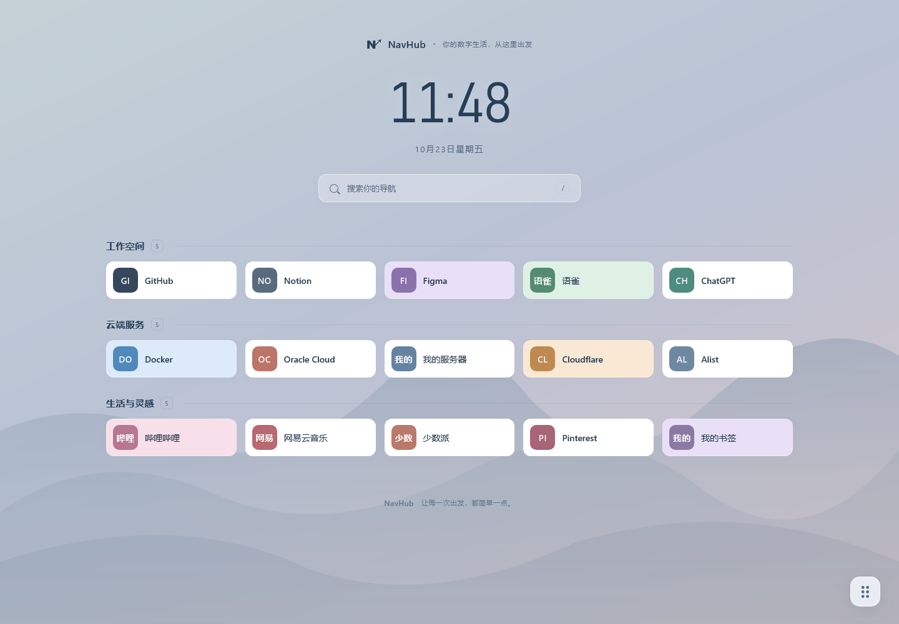

# NavHub

**你的数字生活，从这里出发。**

NavHub 是轻量级、跨平台、自托管的个人导航中心。把分散在服务器、云平台与不同域名上的常用系统，整理成一个安静、美观、随时可达的首页。导航优先、管理简单，下载一个程序就能运行，无需另外安装数据库或前端运行时。

首页采用无侧边栏的沉浸式布局：居中时钟与日期、分类、五列轻卡片，以及右下角浮动操作栏。默认背景为项目自绘的渐变山景，支持自己的图片和颜色。布局参考 Sun-Panel 的使用方式，代码、品牌与视觉素材均未复制。



> 截图中的项目仅为自动化测试示例。正式首次启动是空导航，默认私有访问，没有预置管理员或密码。

源码仓库：[aseeke/NavHub](https://github.com/aseeke/NavHub) · 安装包：[GitHub Releases](https://github.com/aseeke/NavHub/releases/latest)

## V1.0 功能

- 响应式导航卡片：桌面五列，移动端两列；名称、图标、卡片颜色，自定义 HEX 色值。
- 自动文字图标：`GitHub → GI`、`Oracle Cloud → OC`、`数据管理 → 数据`；名称修改时实时预览，无第三方图标 API。
- 分类与项目的新增、编辑、删除；分类隐藏；分类排序、项目分类内排序与跨分类拖动。
- 浏览模式点击访问；管理模式点击编辑，样式与提示清晰区分；支持新标签页或当前页打开。
- 内存搜索名称、URL 与描述，结果保留分类；`/` 打开搜索，`Esc` 关闭，输入框内不拦截 `/`。
- 抽屉与弹窗管理，无额外 Admin 框架；上传图标或背景，支持 PNG、JPEG、GIF、WebP，每张 ≤ 5MB。
- 首次创建管理员、bcrypt 密码哈希、7 天登录会话、登录限流、同源写入检查；默认私有，管理员可改为公开只读。
- 页面标题、背景图片 / 颜色 / 渐变、遮罩、时钟、日期，以及默认卡片颜色、图标底色、圆角、间距、打开方式。
- SQLite 持久化、schema 版本管理、事务保存、并发编辑冲突检测；JSON 导入导出与包含媒体的完整 ZIP 备份。
- Go embed 静态页面，Windows x64 / Linux x64 / Linux ARM64 单文件发布；标准输出和滚动文件日志。

不包含多用户权限、监控、Docker 管理、OAuth、插件市场、自动发现或 AI 功能。

## 快速启动

构建后的程序位于 `release/`。无需安装 Node.js、Go 或 SQLite。

### Windows 10 / 11 x64

将 `navhub-windows-amd64.exe` 重命名为 `navhub.exe`，放入可写目录并双击。首次启动自动创建 `config.yaml` 与 `data/`，检查端口、初始化数据库，并在交互桌面打开浏览器。

```powershell
.\navhub.exe
.\navhub.exe --config .\config.yaml --port 3002
.\navhub.exe --no-browser
.\navhub.exe --version
.\navhub.exe --help
```

访问 [http://127.0.0.1:3002](http://127.0.0.1:3002)，设置管理员账户及至少 10 字节、至多 72 字节的密码。默认监听 `0.0.0.0:3002`，其他设备可通过本机 IP 访问。仅本机使用时把 `host` 改为 `127.0.0.1`。

控制台显示版本、访问地址、监听地址、数据目录与运行状态。按 `Ctrl+C` 正常退出，之后可再次启动。

### Linux x64 / ARM64

按设备架构选择产物，重命名为 `navhub`：

```bash
chmod +x navhub
./navhub
./navhub --config ./config.yaml
./navhub --port 3002
./navhub --version
./navhub --help
```

Linux 不自动打开浏览器。两个 Linux 产物均设置 `CGO_ENABLED=0`，无需系统 SQLite 动态库。

### 配置

默认读取**当前工作目录**的 `config.yaml`，不存在时创建。`data_dir` 的相对路径以**配置文件所在目录**为基准；配置文件的父目录须已存在。端口命令行参数优先于 YAML。完整模板见 [config.example.yaml](config.example.yaml)。

```yaml
host: 0.0.0.0
port: 3002
data_dir: data
open_browser: true
secure_cookie: false
log_file: true
```

`open_browser: false` 或 `--no-browser` 关闭自动打开浏览器。`secure_cookie: true` 用于 HTTPS 反向代理，HTTP 直连时保持 `false`。反向代理须保留原始 Host，服务端据此验证浏览器请求来源。不建议将未配置 HTTPS 的管理登录直接暴露在公网。

## 后台运行

### systemd

以 `/opt/navhub` 为例，先放置二进制和配置、创建专用用户及数据目录，再安装 [deploy/navhub.service](deploy/navhub.service)：

```bash
sudo useradd --system --no-create-home --shell /usr/sbin/nologin navhub
sudo mkdir -p /opt/navhub/data
sudo chown navhub:navhub /opt/navhub/data
sudo cp deploy/navhub.service /etc/systemd/system/navhub.service
sudo systemctl daemon-reload
sudo systemctl enable --now navhub
sudo systemctl status navhub
journalctl -u navhub -f
```

服务文件默认只允许写入 `/opt/navhub/data`；请预先放好 `/opt/navhub/config.yaml`，自定义数据目录时同步修改 `ReadWritePaths`。升级前备份并停止服务，替换程序后启动。

### Windows 服务

程序支持 Windows Service Control Manager 的启动、停止与关机通知；服务模式不会打开浏览器。将程序放在固定目录，预先创建配置和数据目录，并在管理员终端注册（以下路径按实际安装位置修改）：

```powershell
sc.exe create NavHub binPath= '"D:\NavHub\navhub.exe" --config "D:\NavHub\config.yaml" --no-browser' start= auto
sc.exe start NavHub
sc.exe stop NavHub
# 卸载服务，不删除数据
sc.exe delete NavHub
```

服务使用 SCM 配置的身份运行；确保该身份可读配置、可写数据目录。服务名固定为 `NavHub`。Windows 服务注册、关机通知与 systemd 安装尚需目标机器实际验收，见验收记录。

## 使用

1. 创建管理员，点击「添加分类」。
2. 右下角操作栏 → 添加项目；输入名称、HTTP / HTTPS 地址和分类，预览满意后保存。
3. 操作栏 → 管理模式；点击卡片编辑，拖动卡片排序或移入其他分类，完成后退出管理模式。
4. 管理模式 → 分类管理；拖动左侧手柄调整分类顺序，支持重命名和隐藏。
5. 非空分类必须先迁移或单独删除项目才能删除；隐藏分类的项目也可在管理模式下编辑。
6. 系统设置中切换公开 / 私有模式。公开访客不能写入，也不会收到隐藏分类与项目。

保存成功后首页直接更新。若其他窗口已经保存过数据，当前保存会被拒绝并提示重新加载，避免覆盖新数据。排序在搜索状态下停用，清除搜索再拖动。

## 数据与迁移

```text
data/
  navhub.db        SQLite 数据库（运行中还可能有 -wal / -shm 文件）
  uploads/        图标及背景图片，随机文件名
  backups/        手动生成的完整 ZIP 备份
  navhub.log      文件日志，5MB 轮转，保留 3 份旧日志
```

数据库保存导航快照、管理员密码哈希和会话令牌的 SHA-256 摘要，不保存明文密码或明文令牌。导航保存为一个有版本号的 JSON 文档，分类及项目在数组中的顺序即显示顺序；适用于个人导航场景，单次请求 ≤ 4MB、最多 200 分类 / 5000 项目，避免不必要的 ORM 与分页请求。SQLite 使用单连接、WAL 和 5 秒 busy timeout。

### JSON 导入导出

系统设置 → 导出 JSON / 导入 JSON。导出含 `formatVersion`、`revision`、`categories`、`items`、`settings`，不包含管理员密码或登录会话。导入会要求确认，校验后在一个事务内替换导航及设置，失败不修改现有数据，管理员与会话不受影响。

**JSON 仅保存上传文件的引用，不会携带图片文件。** 仅导入 JSON 时需手动复制原来的 `uploads/`，或使用完整 ZIP 备份迁移。外部图标和背景 URL 依赖其原站可访问；默认文字图标完全本地生成。

### 完整备份和恢复

系统设置 → 完整 ZIP 备份。程序通过 SQLite `VACUUM INTO` 创建一致性快照，将 `navhub.db` 和 `uploads/` 一并打包到 `data/backups/`，并下载。备份**包含管理员密码哈希及会话摘要**，请按私密文件保管；不包含 `config.yaml`、旧备份和日志。

恢复步骤：

1. 停止 NavHub，另存当前完整 `data/` 作为回退。
2. 准备新的空数据目录，解压 ZIP，使 `navhub.db` 和 `uploads/` 直接位于目录内；不要把旧 `-wal` / `-shm` 混入。
3. 将 `config.yaml` 的 `data_dir` 指向恢复目录，启动程序，使用备份时的管理员账户登录。

也可以停止程序后打包整个 `data/`。不要只复制运行中数据库的主文件。备份采用手动保留策略，定期删除不再需要的 ZIP。上传文件采用追加保存，替换图标不会自动删除旧文件，以免破坏其他项目引用；如需回收，请停机备份后核对文件引用。

### schema 管理

从 V1 使用 SQLite `PRAGMA user_version=1` 管理结构版本。首次初始化在事务中完成，后续启动校验版本；高于当前程序支持的版本会拒绝启动。未来结构变更须追加事务迁移及数据保留测试。迁移错误停止启动并记录，不清空数据库。

## 本地开发

需要 Go 1.26+、Node.js 22.12+ 与 npm。后端依赖标准 HTTP 库、[modernc.org/sqlite](https://pkg.go.dev/modernc.org/sqlite)、bcrypt 和 YAML；前端使用 [Vue 3](https://vuejs.org/guide/quick-start.html)、[Vite](https://vite.dev/guide/) 与按需使用的 SortableJS，不引入图标全集或 Admin 框架。首次依赖安装需要网络，运行时无外部 CDN 字体和脚本。

终端一：

```bash
go mod download
go run . --no-browser
```

终端二：

```bash
cd web
npm ci
npm run dev
```

打开 Vite 显示的地址（通常是 `http://127.0.0.1:5173`），`/api` 与 `/uploads` 自动代理到 `127.0.0.1:3002`。构建前端后，Go 程序直接提供嵌入的 `static/`；修改前端需要重新构建前端及二进制。

## 测试与发布

```bash
go test -v ./...
go vet ./...
cd web
npm ci
npm test
npm run build
npx playwright install chromium firefox webkit
npm run test:e2e
```

浏览器测试会建立临时数据库和独立 3137 端口服务，不使用真实 `data/`，在 Chromium、Firefox 与 WebKit 中验证新增即时显示、图标、键盘搜索、真实跨分类拖动后刷新、图标上传、公开 / 私有访问、路由回退与响应式布局，生成 `docs/screenshots/` 截图。Windows 上 WebKit 执行较慢，测试使用 20 秒断言等待和 120 秒单用例上限。

一键构建全部平台（前端构建 → 自动测试 → 嵌入资源 → 三平台编译 → SHA256）：

```powershell
# Windows，在项目根目录执行
powershell -ExecutionPolicy Bypass -File scripts/build.ps1
```

```bash
# Linux
sh scripts/build.sh
```

产物：`release/navhub-windows-amd64.exe`、`release/navhub-linux-amd64`、`release/navhub-linux-arm64`，附示例配置、README 和校验值。发布压缩包内程序统一命名为 `navhub.exe` / `navhub`。

详细验收结果及尚未完成的目标环境验证见 [docs/ACCEPTANCE.md](docs/ACCEPTANCE.md)。本项目以 1GB VPS 为运行目标，尚未做真实 1GB VPS 负载测试。

## 工程结构

```text
main.go                 配置、启动、日志与优雅退出
store.go                数据模型、校验、SQLite 与 schema
server.go               会话、导航 API、上传与备份
browser_windows.go      Windows 桌面打开浏览器与 SCM 服务
browser_other.go        Linux 启动行为
server_test.go          API、持久化、权限及恢复测试
web/src/                Vue 首页、表单、样式与自动图标
static/                 构建后的嵌入资源
scripts/                开发验收、启动与发布脚本
deploy/                 systemd 示例
```

页面没有定时请求、监控任务或后台轮询；时钟每分钟只在浏览器更新一次。首页以一次导航请求获取数据，搜索在浏览器完成。主流浏览器兼容性和目标平台实际验证范围以验收记录为准。

## 许可证

NavHub 使用 [MIT License](LICENSE)，允许使用、修改和再分发，请保留版权及许可声明。第三方依赖遵循各自的许可证。
